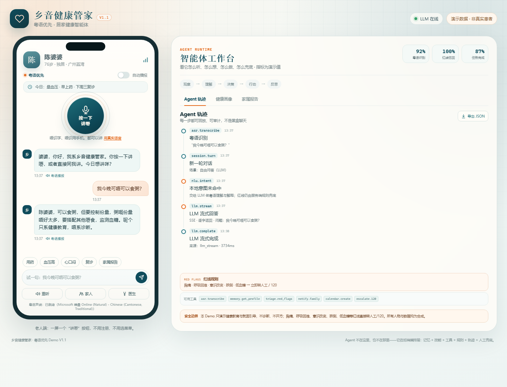

# 乡音健康管家 · 粤语优先 Demo V1.1

一个可点击的「居家健康智能体」演示：老人端只留一个“按一下讲嘢”的按钮，后端展示 Agent 怎么听、怎么想、怎么做、怎么兜底。

## 在线 Demo

https://lf0717qd.github.io/carekeeper-demo/

## 这是什么

- 老人端：一屏一个“讲嘢”按钮；重听 / 家人 / 医生；粤语 TTS。
- 家属端：今日报告、红线告警、代办、授权。
- 专业端：Agent 轨迹、健康画像、告警闭环。
- 场景：用药、血压高、心口闷、复诊、家属报告。
- 安全：胸痛/气促/冷汗等红线走规则，直接转人工/120；不诊断、不开方。

## 手机麦克风提示

如果页面还是旧行为，请强制刷新一次（或关闭页面重新打开），确保加载新版 app.js。

- 微信内置浏览器通常不支持 Web Speech API，请点右上角“在浏览器打开”。
- iPhone：设置 → Safari → 麦克风；或地址栏“aA” → 网站设置 → 麦克风 → 允许。
- Android Chrome：地址栏锁图标 → 权限 → 麦克风 → 允许，然后刷新。
- 如果麦克风已授权但仍报错，多半是浏览器语音服务不支持粤语/国内网络，需要云 ASR。

## 在线版说明

GitHub Pages 只能托管静态页面，不能运行后端。因此在线版：

- 关键场景（用药、血压、红线、复诊、家属报告）仍按脚本演示；
- 自由问答使用预置回答；
- 真实 LLM / 粤语 ASR 需在本地运行 server.py，或把 config.js 的 apiBase 指向你自己的公网后端。

## 关于完整版

本仓库是**静态演示版**，不含后端、不含 API Key。
完整版（真实 LLM / 粤语 ASR / 电话入口）需要后端 server.py 与私有 .env，不在此公开仓库中。

## 文件

- index.html
- styles.css
- app.js
- config.js
- preview.png
- .nojekyll

## 边界

Demo 人物、读数、用药均为合成数据；不构成医疗建议，不诊断、不开方。所有告警/120/家属通知均为模拟。
